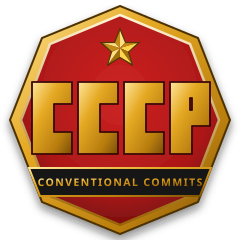

<div align="center">



# CCCP
### Conventional Commits Compliance Program
**«В СВЕТЛОЕ БУДУЩЕЕ С ЧИСТЫМ GIT!»**  
*(Into a bright future with clean Git!)*

[](LICENSE)
[](https://pubs.opengroup.org/onlinepubs/9699919799/)
[](docs/forges.md)
[](https://cccp.2lp.in)

</div>

A comprehensive, zero-dependency POSIX shell tool for enforcing and automating Conventional Commits, predictive Semantic Versioning (SemVer 2.0.0), portable Git hooks, multi-forge ticket synchronization, and AI agent directives.

---

## ⚡ Quickstart

```bash
# 1. Install globally into ~/.local/bin/cccp
curl -fsSL https://cccp.2lp.in | sh

# 2. Enter any Git project and install compliance hooks
cd my-project
cccp install

# 3. Commit with the interactive wizard
cccp cz
```

---

## ★ Key Features

- **Zero Heavy Dependencies**: Pure POSIX shell script (`sed`, `grep`, `cut`, `tr`, no `awk` required). Runs on Linux, macOS, BSD, and Git Bash for Windows.
- **Predictive Semantic Versioning**: Automatically calculates release and pre-release versions based on commit signals (`feat`, `fix`, `BREAKING CHANGE`).
- **Hook Inspectorate & Safety**: Portable wrappers for `commit-msg`, `post-commit`, `pre-push`, and `reference-transaction` with version diffing and backups.
- **Hierarchical Configuration**: 4-tier Gosplan cascade (`Defaults < Global $XDG_CONFIG_HOME/cccp/config < Local .cccprc < ENV < CLI flags`).
- **Multi-Forge Ticket Sync**: Sinks issues from Codeberg/Forgejo, GitHub, GitLab/Framagit, and SourceHut into `.antigravity/tickets.md` with sliding hourly rate limiting.
- **Centralized AI Agent Directives**: Synchronize standardized prompts and workflows into `AGENTS.md`.

---

## 📚 Documentation Chapters

Explore the full documentation in the [`docs/`](docs/) directory or browse the online static site in [`site/`](site/):

| Chapter | Description | Russian Motto |
| :--- | :--- | :--- |
| **[Installation](docs/installation.md)** | Global deployment, local Git hooks, uninstallation. | *«Дать Родине качественный код!»* |
| **[Configuration](docs/configuration.md)** | Hierarchical `.cccprc`, environment variables, CLI options. | *«План — это закон, выполнение — долг!»* |
| **[Versioning](docs/versioning.md)** | Predictive SemVer 2.0.0, bump rules, tag automation. | *«Пятилетку — в четыре года!»* |
| **[Git Hooks](docs/hooks.md)** | Hook squad, post-push scripts, hook auditing & diffing. | *«Ни шагу назад от стандартов!»* |
| **[Multi-Forge Sync](docs/forges.md)** | Codeberg, GitHub, GitLab, SourceHut issue integration. | *«Дружба и сотрудничество всех систем!»* |
| **[AI Agents](docs/agents.md)** | `AGENTS.md` templating, variable resolution with `set-av`. | *«Техника в период реконструкции решает всё!»* |
| **[Command Reference](docs/commands.md)** | Complete CLI syntax: `cz`, `status`, `lint`, `soviet`. | *«Будь начеку и соблюдай дисциплину!»* |

---

## ☭ Order No. 227

> *"Not one step back from Conventional Commits! The State Planning Committee (Gosplan) salutes your discipline!"*

```bash
cccp soviet
```

---

## License

This project is licensed under the [GNU General Public License v3.0 (GPL-3.0)](LICENSE) and GOST 1.1.0 modular matrix.
